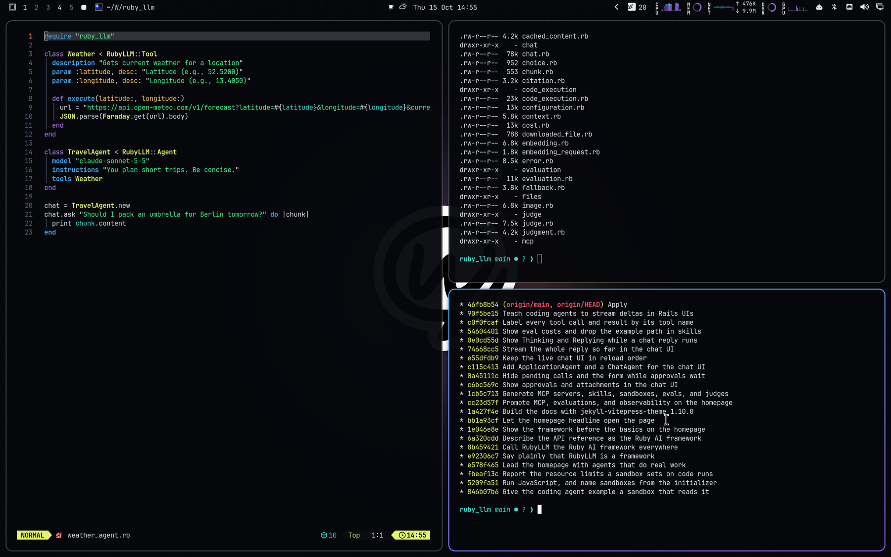

# Chat with Work Dark for Omarchy Quattro

A deep night-blue dark theme with Chat with Work's violet and rainbow glow, sampled from the chatwithwork.com design.



## Install

```bash
omarchy theme install https://github.com/crmne/omarchy-chat-with-work-dark-theme.git
```

Activate it with:

```bash
omarchy theme set chat-with-work-dark
```

## Architecture

This is a declarative Omarchy Quattro theme. It provides only:

- A semantic palette in `colors.toml`
- A GNOME icon theme choice in `icons.theme`
- Wallpapers in `backgrounds/`
- A selector preview in `preview.png`
- A boot unlock logo in `unlock.png`, with its selector preview in
  `preview-unlock.png`

Omarchy generates and applies the terminal, shell, Hyprland, editor, browser,
Obsidian, keyboard, and btop integrations from the semantic palette. The theme
contains no executable hooks, package installation, or application-specific
configuration files.

## Core colors

Sampled from the design tokens of [chatwithwork.com](https://chatwithwork.com).

- Accent: `#9b5cff`
- Muted: `#636b80`
- Background: `#06070b`
- Surface: `#0f121a`
- Foreground: `#e9ecf4`
- Secondary text: `#8d96aa`

## Wallpapers

Original wallpapers made for this theme from the brand's own artwork:

- `01-sticker.jpg`: The sticker mark centered with a deep shadow over a blurred rainbow glow, on a faint dot grid
- `02-orbit.jpg`: The connector orbit: hairline rings (solid, dashed, faint), mark in a surface disc, neon signal satellites
- `03-live-wire.jpg`: A rainbow-lit hairline across the middle with one glowing orange dot, over a dim low rainbow aurora

## Requirements

Omarchy 4 (Quattro) or newer.

## License

[MIT](LICENSE)
